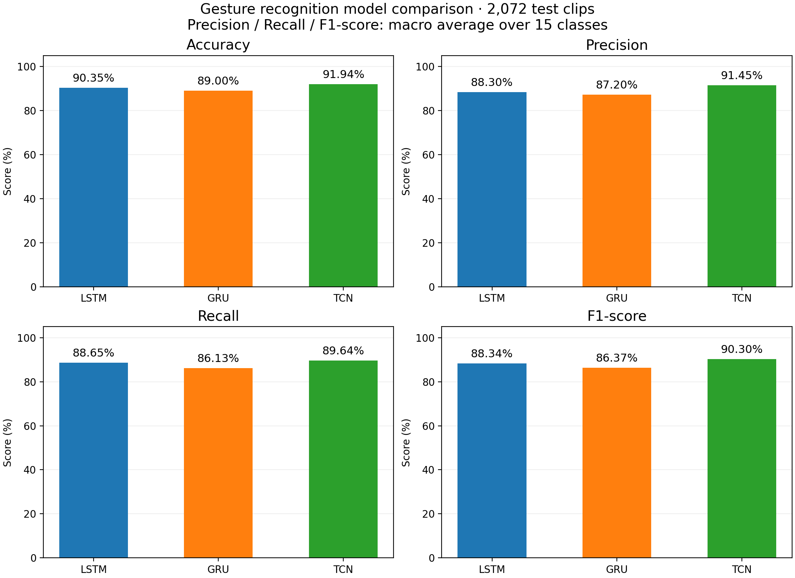

# 基于手部关键点序列的动态手势识别

项目使用 IPN HandS 数据集中的手部关键点序列，分别训练 LSTM、GRU 和 TCN，实现 15 类手势的离线分类和摄像头实时识别。实时画面显示手部骨架、关键点编号、中文类别以及 FPS。

## 功能与文件

| 文件 | 用途 |
| --- | --- |
| prepare_ipn.py | 按官方划分和动作起止帧构建训练、测试样本 |
| train_ipn.py | 定义三种网络并训练、保存权重 |
| evaluate_ipn.py | 加载已有权重，计算测试集正确率 |
| compare_models.py | 计算四项指标，生成 2×2 对比图和 CSV |
| hand_detection.py | 摄像头手部检测与动态手势分类 |
| camera_test.py | 摄像头连接测试 |
| checkpoints/ | LSTM.pt、GRU.pt、TCN.pt 分类权重 |
| models/ | MediaPipe 手部关键点检测模型 |
| data/processed/ | 处理好的训练集、测试集及来源记录 |
| results/ | 指标 CSV、PNG 图及 SVG 矢量图 |

## 环境与运行

使用 Python，安装项目依赖。

```bash
pip install numpy torch opencv-python mediapipe Pillow tqdm matplotlib
```

在 PyCharm 中选择安装了这些依赖的解释器，直接运行相应脚本即可。也可以在项目目录运行下面的命令。

```bash
python hand_detection.py
python evaluate_ipn.py
python compare_models.py
```

摄像头窗口中按 Q 退出，首次运行需允许摄像头访问。当前中文字体使用 macOS 的 STHeiti 字体路径，Windows 或 Linux 用户需将 hand_detection.py 中 ImageFont.truetype 的路径改为本机支持中文的字体。

在 hand_detection.py 顶部修改运行设置。

```python
GESTURE_MODEL = "TCN"       # 可选 LSTM、GRU、TCN
PREVIEW_SIZE = (960, 720)   # 预览窗口尺寸
INFERENCE_INTERVAL = 5    # 每隔多少帧执行一次分类
```

运行参数留空时采用上述模型设置，--model 参数可以覆盖模型选择。关键点逐帧采集，分类之间保留最近一次预测。

## 数据处理

数据来源为 [IPN HandS 官方项目](https://github.com/GibranBenitez/IPN-hand/blob/master/README_HandS.md)。数据归属及使用许可请遵循原项目说明。

每帧取第一只检测到的手，将 21 个点的三维坐标展开为 63 维向量。无手帧填零。按动作标注切分后，等距选择 32 帧，生成形状为 (N, 32, 63) 的输入和形状为 (N,) 的整数标签。训练集包含 5,691 个片段，测试集包含 2,072 个片段。

仓库包含处理好的样本，可直接训练和评估。重新预处理时，需要自行下载官方标注包及 MediaPipe Hands 关键点包，放置为以下目录。

```text
data/ipn_original/
├── annotations/
│   ├── classes.txt
│   ├── splits/
│   └── temporal_annotations/
└── landmarks/
    └── landmarks_mp_hands/
```

运行前创建输出目录，然后执行预处理。

```bash
mkdir -p data/processed/train data/processed/test checkpoints
python prepare_ipn.py
```

原始 ZIP 和逐帧关键点 JSON 通过 .gitignore 排除。metadata.jsonl 记录每个处理后样本的原始视频、起止帧、类别和索引。

## 模型训练

```bash
python train_ipn.py
```

脚本分别从头训练三个模型，保存到 checkpoints，覆盖同名权重。保留旧结果时请先备份。当前配置为 400 轮、批大小 128、Adam 学习率 0.003、随机种子 42。损失采用加权交叉熵，各类别权重为样本数平方根的倒数。

LSTM、GRU 使用 64 维隐藏状态并取最后时间步输出。TCN 使用三层一维卷积，膨胀率为 1、2、4，随后时间平均池化。三种网络均通过全连接层输出 15 类分数。

## 模型对比

compare_models.py 使用同一测试集评估现有权重，输出 Accuracy，以及 15 类宏平均 Precision、Recall、F1-score。分母为零时对应类别的指标记为零。



具体数值见 [指标表](results/model_metrics.csv)。重新训练后需重新运行对比脚本，以更新图表和指标。图中结果衡量已切分动作片段的分类表现，实时摄像头滑动窗口效果需另行验证。
